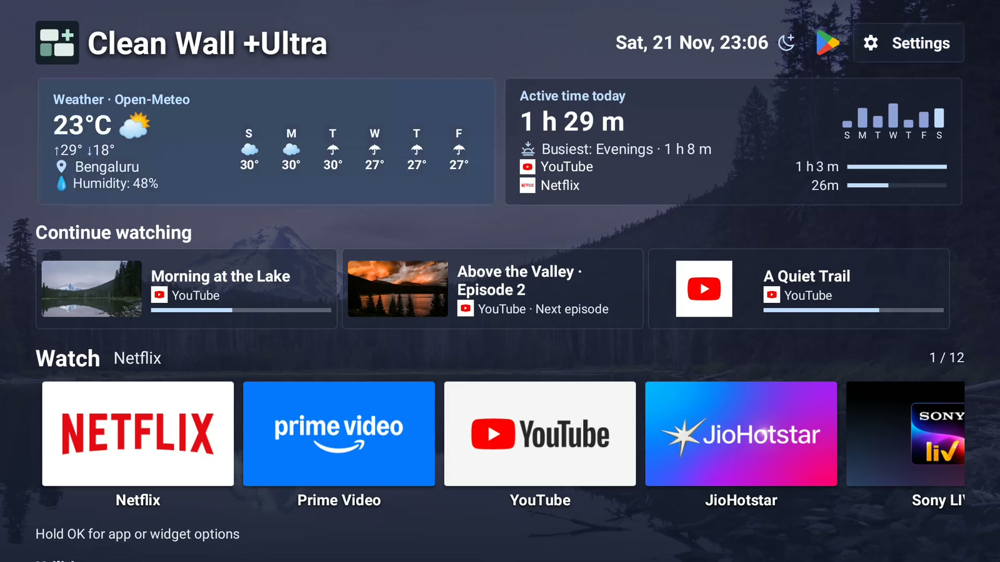
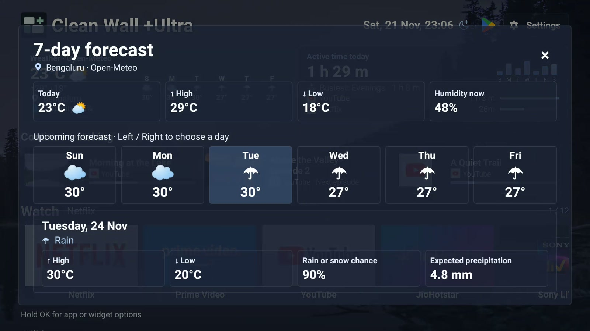
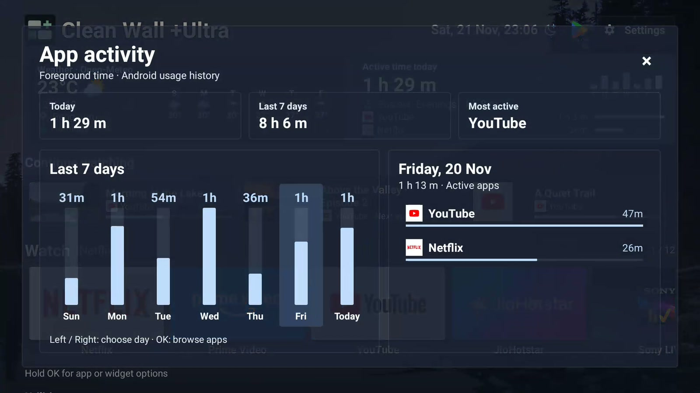
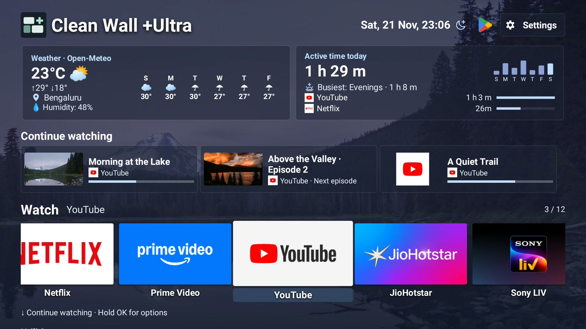
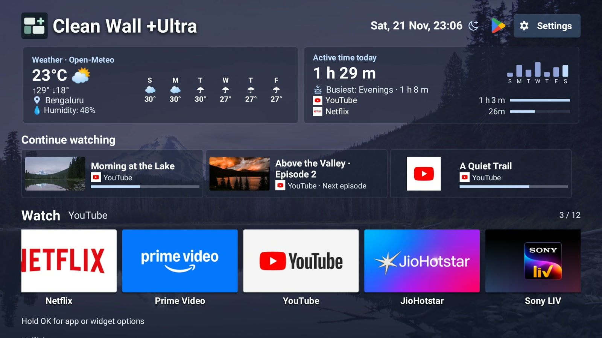
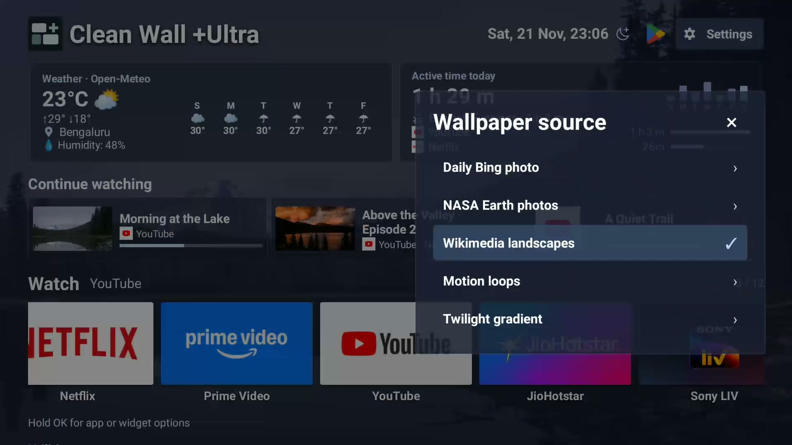
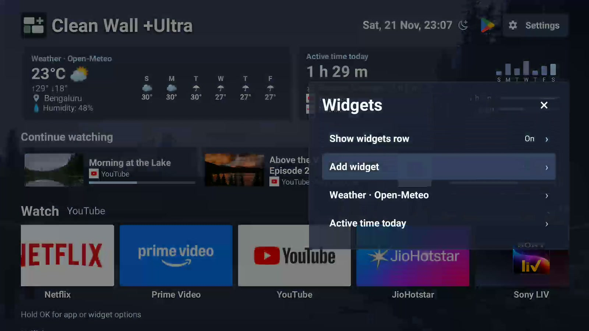
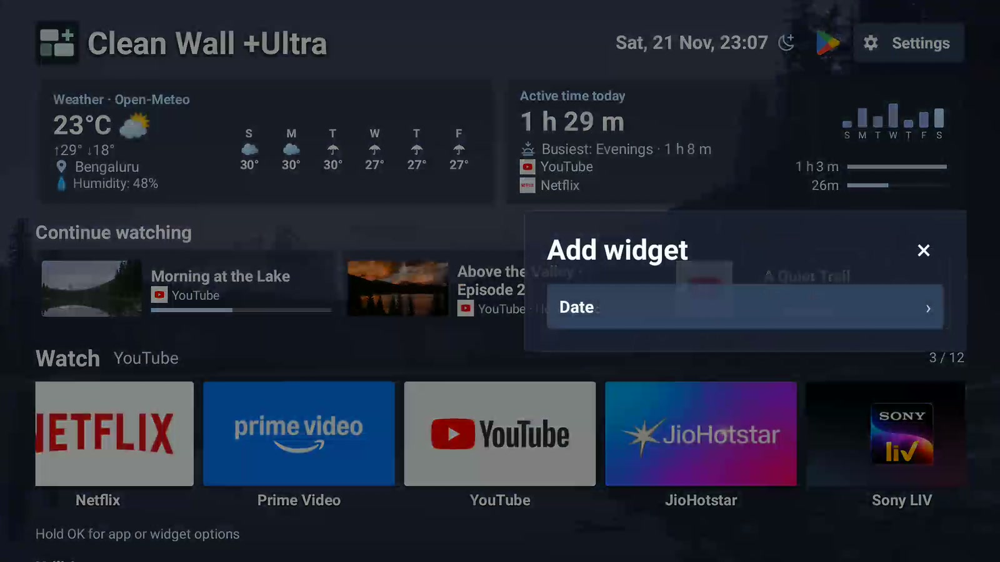

# Clean Wall +Ultra

<table>
  <tr>
    <td></td>
    <td><a href="https://wall.alphacoders.com/big.php?i=809318"></a></td>
  </tr>
</table>

Clean Wall +Ultra is a remote-first launcher for Android TV and Google TV. It brings apps, weather, viewing shortcuts, and app activity together on one home screen. Use the remote to organize apps and customize widgets, wallpapers, motion, and glass tint. Performance depends on the TV and the features in use.

**Requirements:** Android TV with Android 8.0 (API 26) or later. Some features depend on device support, an internet connection, or Usage Access.

## At a glance

- 🎮 Browse Watch and Utilities with the D-pad. Move, hide, restore, or uninstall apps.
- ▶️ Continue watching titles from compatible streaming apps.
- 🌤️ See local weather and app activity, including a seven-day view.
- 🖼️ Choose still or motion wallpapers, glass tint, and reduced motion.
- 🧩 Add, move, configure, and remove Home widgets with the D-pad.
- 🔧 See reported running apps and access force stop with optional Shizuku integration.

[Install on your TV](#get-started) · [TV compatibility](#tv-compatibility) · [Demo and screenshots](#demo-and-screenshots) · [Controls](#controls) · [Continue watching](#continue-watching) · [Wallpaper](#wallpaper) · [Widgets](#widgets) · [Development](#development) · [Contributing](CONTRIBUTING.md)

## Get started

You can install a prebuilt APK (the Android installer file) with your TV remote. Your device must allow app installation.

1. **Get the APK.** On the project's GitHub page, open **Releases**, then download `clean-wall-plus-ultra.apk` under **Assets** when a release is available. If someone shared this project with you directly, ask them for the APK. Developers can [build an APK locally](#development) or [download a CI test build](#download-a-test-build).
2. **Copy the APK to the TV.** Use either method.
   - **USB drive.** Copy the APK to a USB drive. Plug the drive into your TV. Open the drive in the TV's file manager and select the APK.
   - **Android phone.** Download the APK to your phone. Put the phone and TV on the same Wi-Fi network. Install **Send files to TV** on both devices. Select **Receive** on the TV and **Send** on the phone. Select the APK and your TV. Open the received APK on the TV. If it does not open from the transfer app, use the TV's file manager to open the file in the folder shown in the transfer app's settings. [Send files to TV on Google Play](https://play.google.com/store/apps/details?id=com.yablio.sendfilestotv)
3. **Install.** If Android blocks the install, select **Settings** in the prompt and turn on **Allow from this source** for the app that opened the APK. Press Back and select the APK again if necessary. Select **Install**, then **Open**. You can turn the source permission off after installation.
4. **Try the launcher.** Open **Clean Wall +Ultra** from your TV's Apps list at any time. To open it with the Home button, look for **Home app** under **Settings → Apps → Default apps** and select **Clean Wall +Ultra**. Press Home to check. On TVs without a Home app setting, use the Apps list. To go back to your original launcher, select it again in the same setting.

If the TV has no USB file manager or blocks APK installation, try [ADB installation](#install-with-adb) if your TV supports debugging. Menu names vary by TV model. Install APKs from sources you trust. [Google Play Protect on Android TV](https://support.google.com/androidtv/answer/12188351)

**Updates.** Open a newer APK from the same release source and select **Update**. Android requires a matching signing certificate. If you have a test build from a different source, Android can reject the update. Uninstalling to switch builds removes your launcher settings. [Android app signing](https://developer.android.com/studio/publish/app-signing)

**App activity.** Hold OK on **Active time today**, then select **Configure widget → Usage Access**. If your TV does not open that system screen, see [Usage Access with ADB](#deployment).

### Download a test build

If the project is on GitHub and you have access to Actions, sign in and open **Actions → Android checks**. Select a successful run from the branch you want. Download **android-check-results** from **Artifacts**. Extract the ZIP and find `app-debug.apk` in it. This build uses a debug key. For updates that keep your settings, use signed releases or build with the same local key each time. [Download GitHub Actions artifacts](https://docs.github.com/en/actions/how-tos/manage-workflow-runs/download-workflow-artifacts)

### Install with ADB

Use this option if you cannot open the APK on the TV or already use ADB (Android Debug Bridge). Download [Android SDK Platform Tools](https://developer.android.com/tools/releases/platform-tools) on your computer and add the extracted `platform-tools` folder to your PATH.

1. On the TV, open **Settings → System → About** or **Settings → Device Preferences → About**. Select **Build** or **Android TV OS build** seven times if **Developer options** is hidden.
2. Open **Developer options**. If the TV offers **Wireless debugging**, enable it and follow the guide to pair and connect. If it offers **Network debugging**, enable it and connect to the TV's IP address and port. Use `adb connect TV_IP:5555` if the TV uses port 5555. Replace `TV_IP` with the TV's address. Approve the connection prompt on the TV. [Connect with ADB](https://developer.android.com/tools/adb#connect-to-a-device-over-wi-fi)
3. Run these commands from the folder that contains the APK. Use the name of your downloaded file in the install command. If more than one device appears, add `-s SERIAL` after `adb`, with the TV's serial from `adb devices`.

   ```sh
   adb devices
   adb install -r clean-wall-plus-ultra.apk
   adb shell am start -n dev.lprakashv.cleanwall/.MainActivity
   ```

4. If you enabled debugging for this installation, turn it off on the TV when you finish.

## TV compatibility

Clean Wall +Ultra supports Android TV OS 8.0 (API 26) and later, including Google TV. The same APK works on 32-bit and 64-bit Android because it contains no native libraries. Home leaves a 5% margin around its controls for TVs that crop the edges of the picture. [Android 16 for TV](https://developer.android.com/tv/release/16) · [TV layout guidance](https://developer.android.com/training/tv/playback/compose/layouts#overscan)

Launch, D-pad navigation, Back, and Android settings passed on these test devices.

| Device | Android version | Display |
| --- | --- | --- |
| OnePlus TV (32-bit) | 11 | 1080p |
| Android TV emulator (64-bit) | 16 | 720p |
| Google TV emulator (64-bit, 16 KB pages) | 16 | 4K |

Your TV firmware controls which apps you can install and which app the Home button opens. If your TV accepts the APK but keeps its built-in Home app, open Clean Wall +Ultra from the Apps list.

Google Play, Usage Access, Continue watching, and Shizuku depend on the device and available services. You can browse apps and use launcher settings when these services are unavailable.

## Demo and screenshots

[Watch the 49-second demo (MP4)](docs/clean-wall-demo.mp4). It shows D-pad navigation from Home to the forecast, App activity, Continue watching, app actions, wallpaper, and widgets. The demo and screenshots show sample viewing and activity data on an Android 11 TV.



| Weather forecast | App activity |
| --- | --- |
|  |  |
| **Continue watching below an app** | **App actions** |
|  |  |
| **Settings** | **Wallpaper sources** |
|  |  |
| **Widgets** | **Add widget** |
|  |  |

## Controls

Use Left and Right to browse a row and OK to open an app or widget action. Focused cards grow slightly. A tinted label shows which app has focus. Reduce motion disables the animation.

- **Watch** includes the streaming apps Clean Wall +Ultra recognizes. **Utilities** contains the other apps. Select the Google Play icon to install apps. The Settings gear opens the launcher menu.
- Hold OK on a card to open its actions. Choose **Pick up to move**, use Left or Right, then press OK to drop or Back to cancel. You can move an app to another row, hide it, or select **Uninstall** to open Android's confirmation. **Settings → Hidden apps** lets you open, restore, or uninstall a hidden app.
- A dot on an app card means Android reports a running process, which can be idle. The dot refreshes every 10 seconds while Home is open. Set up [Shizuku](#running-apps) to use this feature. Hold OK on a card with a dot and select **Force stop** to stop the app. Android can start it again when needed. Force stop can interrupt playback and discard unsaved work.
- To use Android's own controls, hold OK on a card, select **App info**, then select **Force stop** in Android settings if available.
- Use Up and Down to move between the menu bar, widgets, Continue watching, Watch, and Utilities. Focus skips hidden and empty rows. Home remembers the last focused tile in each row.
- On the Home screen, Back leaves the launcher open. When you open Clean Wall +Ultra from the Apps list, Back returns to the previous screen.
- Open **Settings** to manage widgets or change the wallpaper, glass tint, or motion. Press Back in a submenu to return to its parent menu. Glass tint applies to Home and all Clean Wall +Ultra dialogs and menus, including App activity. Settings opens from the side so Home stays visible.
- The status bar shows the logo, the local date and time, and an icon for the current time block. Weather refreshes every 15 minutes while Home is visible. Open-Meteo receives the city search or the selected city's coordinates.
- The Weather card shows the current temperature, condition icon, today's high and low, and humidity on the left. A location pin marks the selected city. The forecast on the right shows the high and a condition icon for each upcoming day. Press OK and use Left or Right to see each day's condition, high and low, chance of rain or snow, and expected precipitation. The app omits zero or unavailable precipitation readings. Hold OK and choose **Configure widget** to change the city.
- **Active time today** labels the busiest time block and shows its icon and duration. It compares the top two apps with their icons and bars. Each bar in the 7-day chart has a day initial below it. The local time blocks are Mornings (06:00–12:00), Daytime (12:00–18:00), Evenings (18:00–22:00), and Late nights (22:00–06:00).
- Select **Active time today** to open App activity. Use Left or Right to choose a day. Press OK to browse apps with their icons and select one for its 7-day trend. Clean Wall +Ultra counts foreground time for other apps. It excludes locked and display-off time when Android reports those events.

## Continue watching

Open **Settings → Continue watching → Show Continue watching** and allow TV listings access. Continue watching is off by default.

- **App sources** uses all apps in the Watch row by default. Choose **Selected apps** to include specific apps from Watch. Press OK to turn a source on or off. Changes take effect immediately. Press Back to return to Home. Only apps that share Watch Next entries on this TV can supply titles.
- Turn **Home row** and **Below each app** on or off independently. Both use the same app sources. The Home row shows up to ten recent titles and next episodes above Watch, with up to five per app. Home skips the row when no titles are available.
- **Below each app** opens a list below the focused Watch app when you press Down and titles are available. The list can cover part of Utilities. The Utilities row stays in place. Press OK on a title to open it in the streaming app. Press Back or Up from the first title to return to the app tile. Press Left or Right from any title, or Down from the last title, to go to Utilities when that row is available.

Both views show a progress bar when playback position and duration are available. Titles at 98% or more are hidden. Next episodes and titles without progress remain visible.

The TV and streaming app control which entries, artwork, and playback links are available. The streaming app can require profile selection before it resumes a title. Clean Wall +Ultra reads the TV's local Watch Next entries when Home opens and checks for updates each minute while Home is visible. Artwork can load from the streaming app or its image server. Clean Wall +Ultra keeps entries and artwork in memory and saves only the layout, visibility, and app-source settings.

## Running apps

Install [Shizuku](https://shizuku.rikka.app/download/) and start its service with ADB or root. On a non-rooted device, start it again after each reboot; see the [Shizuku setup guide](https://shizuku.rikka.app/guide/setup/). Open **Settings → Running apps · Shizuku** in Clean Wall +Ultra and allow access. If you deny access permanently, change the permission in Shizuku. The settings row shows **Connected** when a process check succeeds and **Access needed** when the service or data is unavailable. Without a current check, Home does not show dots.

The launcher checks the current Android user's process list through Shizuku while Home is visible. A running process does not mean the app is playing media or using the network. The check uses Android system interfaces that can differ by TV and Android version. Force stop uses the ADB shell identity and can fail if the TV restricts it. App info remains available without Shizuku.

The [Shizuku API](https://github.com/RikkaApps/Shizuku-API) uses the MIT license. Shizuku uses the Apache 2.0 license; see its [license and usage terms](https://github.com/RikkaApps/Shizuku#license).

## Wallpaper

Open **Settings → Wallpaper** to select a source, set the update frequency, or select **Refresh wallpaper now**. The intervals are 30 minutes, 1 hour, 6 hours, 12 hours, daily, and weekly. Clean Wall +Ultra checks the schedule while Home is open and when it resumes. Bing publishes one image per day. The bundled Wikimedia and Motion collections work offline. The app shows media credits on Home.

Select **Wikimedia online** to show **Media type** and **Category** in the same menu. Choose still photos or moving videos. To choose a category, enter a search term and select a result from Wikimedia. The default category is Landscapes. No account or API key is required. If an earlier version used NASA or Pixabay, the app selects Wikimedia online. Other saved source choices stay the same.

Wikimedia stills come from community-featured pictures marked CC0. The app searches for featured CC0 videos first. If none fit the TV limits, it searches other CC0 videos in the selected category. Wikimedia does not provide a general Safe Search option. A category can have no suitable results. The app treats videos of 30 seconds or less as short. Videos are limited to 1080p; they loop without sound and may not loop seamlessly. Reduce motion shows a still frame. See [Wikimedia reuse guidance](https://commons.wikimedia.org/wiki/Commons:Reusing_content_outside_Wikimedia) and [Art and media credits](#art-and-media-credits).

### Storage and cleanup

Clean Wall +Ultra keeps one Bing image, the most recent online wallpaper, and copies of the current bundled wallpaper catalog for offline use. On startup and once a day while Home is open, the app checks its private wallpaper caches on a worker thread. It removes interrupted downloads and retired wallpaper entries, including retired NASA and Pixabay cache files. It keeps the current online wallpaper. It recovers the previous Bing cache file if a backup is available.

Clean Wall +Ultra also removes unfinished copies left by the former layout import on startup. Previously saved layouts and their backups remain available for reference.

## Widgets

Weather and Activity are on Home by default. Open **Settings → Widgets → Add widget** to add a card from the catalog. The catalog includes Date, Weather, and Activity. A removed card becomes available to add again. Each card has a minimum width. Use Left and Right to scroll the row when more cards are available than fit on the screen.

Use **Settings → Widgets → Show widgets row** to show or hide the whole row. The launcher keeps your widgets, their order, and their settings.

Hold OK on a widget to open its options. Choose **Pick up to move**, use Left or Right, then press OK to drop it or Back to cancel. Choose **Configure widget** to change the Weather city, manage Usage Access and display options for Activity, or show the year on the Date card. Choose **Remove from Home** to remove a card. Clean Wall +Ultra saves the order and options.

### Define a widget in Kotlin

Add cards to [WidgetCatalog.kt](app/src/main/java/dev/lprakashv/cleanwall/WidgetCatalog.kt) and rebuild. Give each card a stable `WidgetId` key, then add its definition to `WidgetCatalog.available`. Add the ID to `WidgetCatalog.defaults` if the card must appear on Home for a new installation.

Each `WidgetSpec` sets a title resource, an optional source, a minimum width in dp, a style, and an OK action. Its Kotlin function returns `WidgetContent` with text and optional detail and icon. For a static card, add a title string resource and a card such as this one.

```kotlin
WidgetId.MOVIE_NIGHT to WidgetSpec(title = R.string.movie_night, style = WidgetStyle.NOTE) {
    WidgetContent("Friday at 8")
}
```

Use the device source and app shortcut types in [WidgetData.kt](app/src/main/java/dev/lprakashv/cleanwall/WidgetData.kt) for device data. Use `WidgetSource.Remote` with a loader function for an API or another remote source. The loader runs on a worker thread. Give network calls timeouts and a response size limit. Cards that use the same source instance share results. Updates can run when Home opens, on an interval, or when the card uses the refresh action. The launcher holds remote results in memory.

## Development

Install JDK 17, Gradle 9.9.2, Android SDK platform 35, and build tools 35.0.0. Set `ANDROID_HOME` to the SDK directory and add the SDK platform-tools directory to your `PATH`. This repository does not include a Gradle wrapper.

Build and check the app:

```sh
gradle :app:assembleDebug :app:lintDebug :app:testDebugUnitTest
```

Generate the unit test coverage report at `app/build/reports/coverage/test/debug/index.html`:

```sh
gradle :app:createDebugUnitTestCoverageReport
```

Install the debug build on an [authorized TV](#install-with-adb):

```sh
adb install -r app/build/outputs/apk/debug/app-debug.apk
adb shell am start -n dev.lprakashv.cleanwall/.MainActivity
```

The debug APK is signed with the local Android debug key. Keep that key to install later updates over this build. You can also copy `app-debug.apk` to a USB drive and follow the [TV install steps](#get-started).

## Deployment

For a release that users can install and update, increase `versionCode` in `app/build.gradle.kts` for each update. Build and sign the release APK with the same release key each time. Keep the key outside the repository and keep a secure backup. Use an [Android Studio release keystore](https://developer.android.com/studio/publish/app-signing) if you need to create one.

```sh
gradle :app:assembleRelease
"$ANDROID_HOME/build-tools/35.0.0/apksigner" sign \
  --ks /path/to/release-keystore.jks \
  --out app/build/outputs/apk/release/clean-wall-plus-ultra.apk \
  app/build/outputs/apk/release/app-release-unsigned.apk
"$ANDROID_HOME/build-tools/35.0.0/apksigner" verify \
  app/build/outputs/apk/release/clean-wall-plus-ultra.apk
```

Replace `/path/to/release-keystore.jks` with the key's file path. If the keystore has more than one key, add `--ks-key-alias` with the alias. Attach the signed APK to the GitHub release or give it directly to the TV owner. For a GitHub release, attach the APK under **Assets** so users can download it from the release page. [Create a GitHub release](https://docs.github.com/en/repositories/releasing-projects-on-github/managing-releases-in-a-repository)

Android treats `dev.lprakashv.cleanwall` as a separate app if an older build has a different package ID. Launcher settings and Usage Access stay with the old package.

### Usage Access with ADB

If the TV cannot open the Usage Access screen, [connect with ADB](#install-with-adb). With the TV owner's approval, grant access after installation.

```sh
adb shell cmd appops set --user 0 dev.lprakashv.cleanwall GET_USAGE_STATS allow
```

Set the same operation to `default` to revoke the grant.

## Repository map

| Path | Purpose |
| --- | --- |
| `app/src/main/java/dev/lprakashv/cleanwall/` | Launcher UI, Watch Next, widgets, wallpaper, weather, and activity logic. |
| `app/src/main/res/` and `app/src/main/assets/` | Android resources and bundled wallpaper media. |
| `app/src/test/` | Local unit tests. |
| `WidgetCatalog.kt` | Kotlin definitions for the Home widget row. |
| `docs/images/` and `docs/clean-wall-demo.mp4` | TV screenshots and a D-pad demo. |
| `.github/workflows/android.yml` | Build, lint, unit test, and coverage checks. |
| `AGENTS.md` | Project conventions and guidance for AI agents. |

See [CONTRIBUTING.md](CONTRIBUTING.md) for the review and testing workflow. CI does not replace testing with a TV remote.

## Art and media credits

The logo combines three wall tiles and a plus sign. The TV banner uses “Plus Ultra” as a reference to *My Hero Academia*.

The All Might artwork is linked from [Wallpaper Abyss](https://wall.alphacoders.com/big.php?i=809318). The source states that the image is free for private, personal use and asks users to contact the artist for other uses. Character and artwork rights belong to their respective owners.

Wallpaper sources and credits:

- **Wikimedia online:** CC0 files from [Wikimedia Commons](https://commons.wikimedia.org/). Credits appear on Home.
- **Wikimedia landscapes:** [Lake Mountain Landscape](https://commons.wikimedia.org/wiki/File:Lake_Mountain_Landscape.jpg) by Bonnie Moreland and [Mountain Lake Sunset](https://commons.wikimedia.org/wiki/File:Mountain_Lake_Sunset.jpg) by 420 Photography. Both are CC0 and are resized to 1920 pixels wide.
- **Motion loop:** [Small waterfall](https://commons.wikimedia.org/wiki/File:Small_waterfall.webm) by [YouTube Editor](https://www.youtube.com/user/Editor) under [CC BY 3.0](https://creativecommons.org/licenses/by/3.0/). The app includes a silent 1080p MP4 version of Small waterfall.

## License

Project code is available under the [MIT License](LICENSE). Third-party media and trademarks have their own rights and terms.
